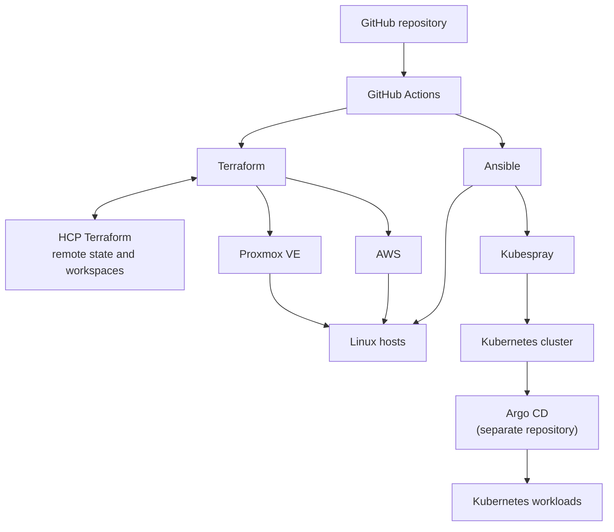

# Infrastructure as Code

Personal hybrid infrastructure automation built with Terraform and Ansible on top of Proxmox VE and AWS. Full CI/CD pipeline built with GitHub Actions provides change control and validation. Kubernetes application delivery is handled in a separate [Argo CD repository](https://github.com/rs235/project-argocd).

This project focuses on providing reproducible infrastructure, reusable configuration and clear separation between infrastructure provisioning, system configuration and application delivery. It manages resources running on top of already existing home environment with Proxmox VE, TrueNAS, OPNsense, self hosted GitHub Actions runner and physical network devices which lie outside of the scope of this project.

Architecture



#### Responsibilities

| Component | Responsibility |
|---|---|
| Terraform | Provisions infrastructure such as Proxmox VMs and LXCs, AWS instances, VPCs and security groups. |
| HCP Terraform | Stores Terraform state remotely. Terraform state is separated between main parts of infrastructure to minimize "blast radius" of potential mistakes. |
| Ansible | Bootstraps Linux hosts and deploys applications and services with their configuration. |
| Kubespray | Installs and configures Kubernetes on Proxmox virtual machines. Kubespray repository is configured as a git submodule and shares inventory and configuration with main Ansible setup. |
| GitHub Actions | Runs pull request triggered validation steps like security and secret scans, linting, Kubernetes / Argo CD schema validation, Terraform plans, Ansible checks. Automatically executes post merge infrastructure changes. |
| Argo CD | Automates Kubernetes application deployment from the separate Argo CD repository. |

There is a clear separation between roles of Terraform, Ansible and Argo CD as reflected by repository structure and Actions workflows. Terraform manages infrastructure resources, while Ansible configures the operating systems and services running on them with as little overlap as possible. Argo CD is responsible for Kubernetes workloads and its configuration is kept in a separate repository. This approach keeps the configuration clean and easy to maintain.

## Environments

This project has been designed with support for multiple environments and multi K8s cluster setups. It can be easily expanded to support additional cloud providers.

### Proxmox VE

Terraform provisions and manages selected parts of home infrastructure on an already existing and precofnigured Proxmox VE host. Terraform state is kept separately for large systems like Kubernetes cluster and arbitrary groups of VMs organized by their functionality.

Ansible configures Linux hosts and uses Kubespray to deploy highly available Kubernetes cluster with three control planes and three worker nodes.

### AWS

Terraform provisions AWS resources like EC2 instances, VPCs and security groups. Instances use encrypted EBS storage and cloud-init to configure the Ansible SSH account.

Ansible bootstraps instances and deploys services alongside their configuration. Example website that runs on hardened, unprivileged Nginx container is deployed as an example workload. Reverse proxying and HTTPS termination is provided by Caddy running directly on the Linux host. SSH access is  limited by a security group to a specific source adress.

## Repository layout

```text
.
├── .github/workflows/           # GitHub Actions workflows
├── ansible/
│   ├── inventories/             # Inventories and variables separated per environment
│   ├── playbooks/               # Ansible playbooks
│   ├── roles/                   # Reusable Ansible roles
│   ├── requirements.txt         # Pinned dependencies
│   └── requirements.yml         # Ansible Galaxy collections
├── dependencies/
│   └── kubespray/               # Kubespray Git submodule
└── terraform/
    ├── environments/
    │   ├── home/                # Proxmox VE root modules
    │   └── aws/project/         # AWS root modules
    └── modules/
        ├── proxmox/             # Reusable Proxmox VE child modules
        └── aws/                 # Reusable AWS child modules
```

## CI/CD

This project's GitOps pipeline have been built on GitHub Actions with small, caller workflows that trigger larger, reusable workflow to reduce code repetition and reduce maintenance burden. 

### Terraform

For pull requests that change Terraform managed infrastructure the workflow:
1. Verifies YAML formatting with yamlint.
2. Checks for leaked secrets with Gitleaks.
3. Scans for vulnerabilities with Trivy.
4. Lints Terraform files with TFLint.
5. Runs Terraform plan, comments the plan to pull request and saves it as an artifact.

After the change is merged to `main`, a separate workflow runs `terraform apply`. Workspaces are selected explicitly by the workflow, and concurrency groups prevent overlapping operations for the same managed system. Workflows can also be started manually.

### Ansible

For pull requests that affect Ansible configuration, the workflow:
1. Verifies YAML formatting with yamlint.
2. Checks for leaked secrets with Gitleaks.
3. Scans for vulnerabilities with Trivy.
4. Ansible syntax check.
5. Ansible check.
6. Comments Ansible check output to PR and uploads it as an artifact.

After the change is merged to `main`, a separate workflow executes the Ansible playbook, applying the changes. SSH keys and Ansible Vault files are written to temporary files at runtime with restrictive permissions. Concurrency groups prevent overlapping operations for the same managed system. Workflows can also be started manually.

### Runner separation

Validation jobs that don't need access to infrastructure and secrets run on GitHub-hosted runners. Operations requiring access to parts of infrastructure run on a self-hosted runner.
This approach allows for tighter security, especially in relation to network access rules and reduces unnecessary load on self-hosted infrastructure by leverage GitHub provided resources.

## Security

- Credentials are kept as GitHub repository secrets or stored in Ansible Vaults.
- Terraform state is kept in HCP Terraform.
- Changes to infrastructure go through a PR review process before being applied.
- Changes are previewed via Ansible checks and Terraform plans.
- All workflows contain comprehensive set of checks including security and secret scans.
- GitHub Actions are pinned to commit SHAs. All tools and their dependencies are pinned to specific version.
- AWS securtity groups and PVE firewalls (not yet managed in this repository) restrict network access to the necessary minimum.
- AWS website uses an unprivileged Nginx container, with host-level Caddy handling HTTPS/reverse proxying.
- Kubernetes website access is additionally secured by NetworkPolicies and host firewall rules.

## State management

Terraform is configured to use the HCP Terraform cloud backend for remote state storage. Each Terraform root module has its own, separate state reducing the risk of unrelated changes affects other environments.
HCP Terraform authentication is provided at runtime through TF_API_TOKEN GitHub secret. Terraform state files and local .terraform directories are excluded from repository.

## Scope and design choices

This is a personal infrastructure project, not a turnkey module intended to deploy unchanged into arbitrary environments. Environment-specific IP addressing, provider configuration, credentials, and existing Proxmox resources must be adapted before reuse.
The architecture intentionally avoids adding separate tools where the existing stack already covers the requirement:

- Terraform provisions resources; Ansible configures hosts.
- Kubespray bootstraps Kubernetes; Argo CD manages applications.
- GitHub Actions validates and executes infrastructure changes; it does not replace Argo CD's ongoing reconciliation of Kubernetes workloads.
- Separate Terraform roots/workspaces isolate systems without creating artificial development, test, and production environments.

## Related repositories

[Argo CD repository](https://github.com/rs235/project-argocd)

[Website repository](https://github.com/rs235/project-website)

## Future improvements

- Manage Proxmox VE firewall configuration with Terraform.